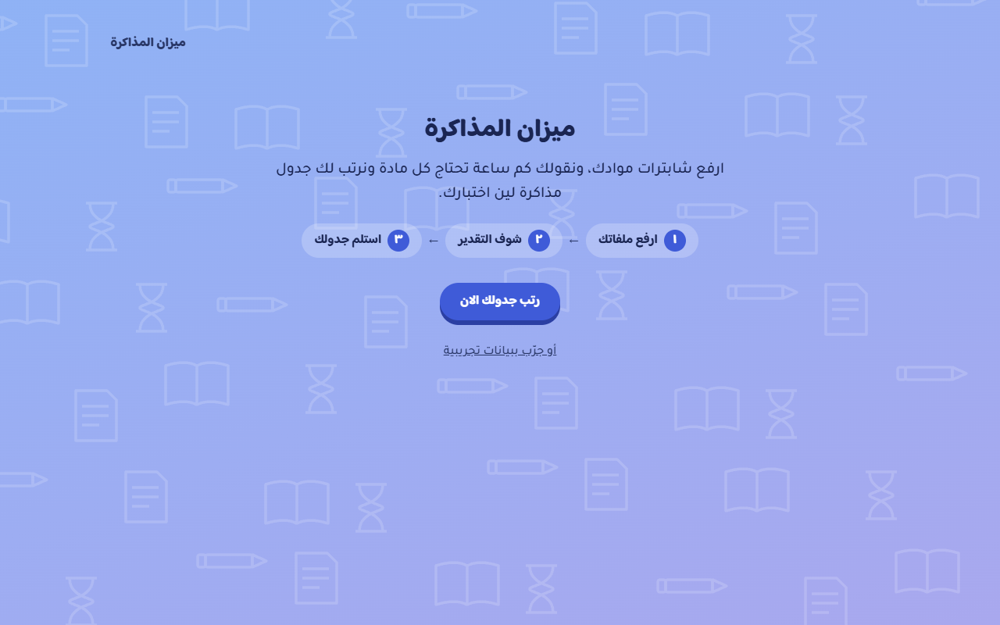
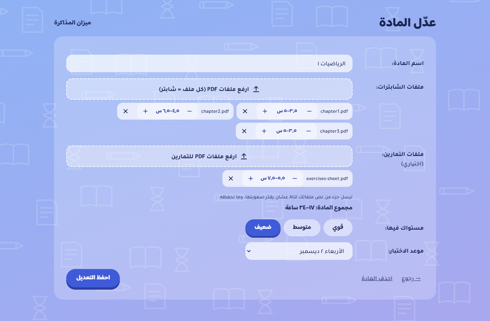
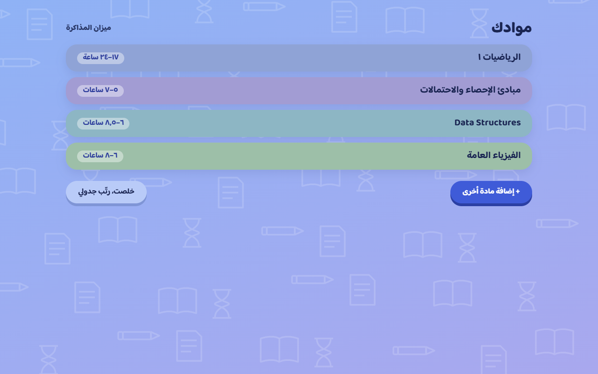
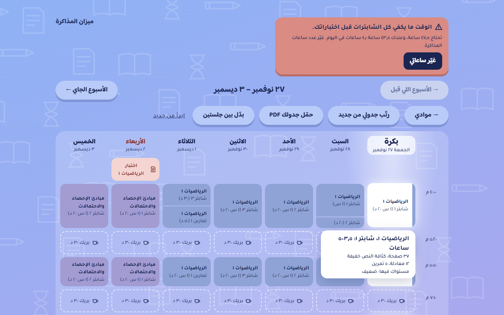
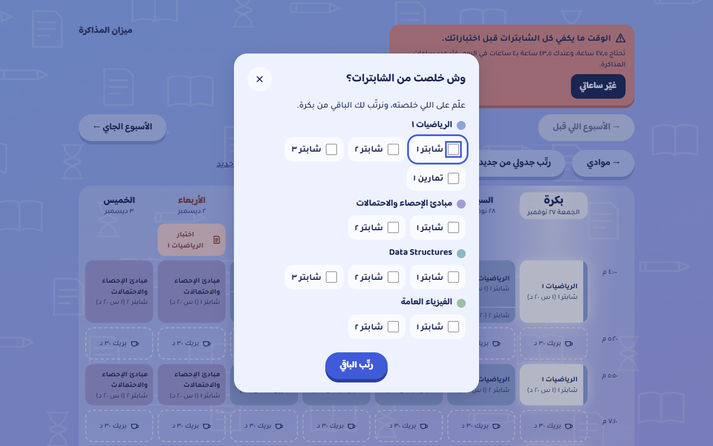
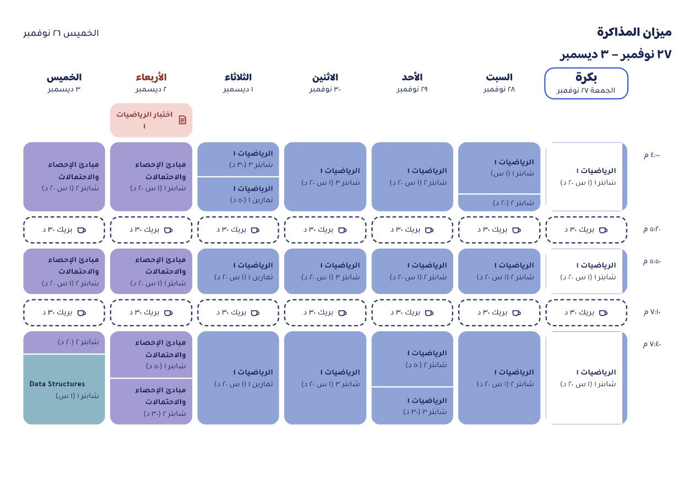
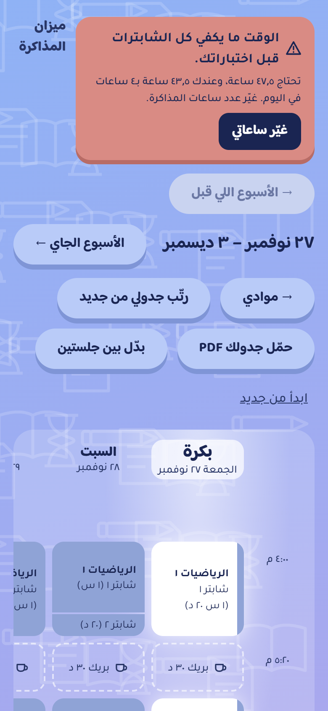

<div dir="rtl">

# ميزان المذاكرة

ارفع ملفات شابترات موادك، وميزان المذاكرة يقولك كم ساعة تحتاج كل مادة ويرتّب لك جدول مذاكرة أسبوعي لين آخر اختبار.

**جرّبه:** https://m1zan.vercel.app

## المشكلة
طالب الجامعة قبل الاختبارات يذاكر بشكل عشوائي، لأنه ما يعرف كم وقت تحتاج كل مادة.
المادة اللي استسهلها تطلع أصعب مما توقع، فتضغطه في آخر الأيام قبل اختبارها.
ميزان المذاكرة يحوّل ملفات المواد نفسها إلى تقدير ساعات وجدول يمشي عليه.

## صور من البرنامج
كل الصور من «أو جرّب ببيانات تجريبية».

**البداية:** جملة تشرح الفكرة، و٣ خطوات، وزر واحد.



**إدخال المادة:** كل ملف يطلع فيه مدى ساعاته، و− و+ لو حسّيته غلط، ومجموع المادة تحتهم.



**قائمة المواد:** كل مادة بلونها ومدى ساعاتها.



**الجدول:** أسبوع يبدأ بـ«بكرة»، وتحذير إذا الوقت ما كفى، وسبب التقدير يطلع لما تمرّ أو تضغط على الجلسة.



**«رتّب جدولي من جديد»:** علّم على اللي خلصته، والباقي يترتب من بكرة.



**«حمّل جدولك PDF»:** كل أسبوع في صفحة A4 بالعرض، تطبعه أو تفتحه من جوالك.



**على الجوال:** الأسبوع يتحرك يمين ويسار داخل كرته.



## وش يسوي
- تضيف لين ٦ مواد: اسم المادة، وملفات الشابترات (PDF)، وملفات التمارين لو عندك، ومستواك فيها (قوي، متوسط، ضعيف)، وموعد اختبارها.
- يقرأ كل ملف على جهازك ويعطيه مدى ساعات مع السبب، وتقدر تعدّل أي مدى بنص ساعة.
- تحدد كم ساعة تذاكر في اليوم، والبريكات، ومتى تبدأ ومتى تخلص، ويطلع لك جدول أسبوعي من بكرة لين آخر اختبار. الملفات بترتيب الاختبارات، والجلسة الوحدة ممكن تجمع أكثر من ملف.
- إذا الوقت ما كفى، يقولك كم ناقص ويعرض عليك تزيد ساعاتك.
- الجدول يبقى صحيح مع الأيام: اللي فات ينحسب إنك ذاكرته، وتقدر تعلّم وش خلّصت وترتّب الباقي، أو تبدّل بين جلستين.
- تعدّل مادة أو تحذفها، وتحمّل جدولك PDF.

## كيف يقدّر الوقت
- **المعادلة تقيس الحجم:** عدد الصفحات، وكثافة الكلام في الصفحة، والمعادلات، والتمارين، ومستواك في المادة.
- **الـAI يحكم على الصعوبة:** لما تحفظ المادة، يقرأ جزء صغير من نص كل ملف ويعطيه صعوبة من ١ لين ٥ مع سبب، مثل «فيه تحويل الأعداد الثنائية إلى عشرية».
- **الساعات = المعادلة × الصعوبة:** صعوبة ٣ تعني المعادلة نفسها، و١ أقل بـ٣٠٪، و٥ أكثر بـ٤٠٪. فنفس الملف ياخذ نفس الساعات دايماً.
- **إذا الـAI ما رد**، المعادلة لحالها تكفي، وما يطلع لك أي خطأ.
- الجدول ياخذ الحد الأعلى من كل مدى، عشان ما تضغطك مادة في آخر الأيام.

## الخصوصية
- ملفات الـPDF تنقرا على جهازك وما تنحفظ ولا تطلع منه. اللي ينحفظ بس أرقامها (الصفحات والكلمات وغيرها).
- لما تحفظ مادة، جزء صغير من نص كل ملف جديد (تقريباً ١٥٠٠ حرف) يروح للـAI عشان يقدّر صعوبته، وما ينحفظ في أي مكان. الشاشة تقولك كذا قبل الحفظ.
- ما فيه حسابات ولا قاعدة بيانات: موادك وجدولك محفوظة في متصفحك بس.

## التقنيات
- **الواجهة:** React 18 وVite 5 وJavaScript، وCSS عادي فيه كل الألوان والأحجام كـtokens في ملف واحد.
- **قراءة الـPDF:** pdf.js في المتصفح.
- **الحفظ:** `localStorage` في المتصفح.
- **الـAI:** serverless function واحدة على Vercel (`web/api/ai.js`) تكلّم أي مزوّد بصيغة OpenAI. حالياً Groq مع `openai/gpt-oss-120b`. المفتاح على السيرفر بس، وما يوصل للمتصفح أبداً.
- **الاختبارات:** Vitest (٢٣٥ test).
- **الاستضافة:** Vercel.

## تشغيله على جهازك
تحتاج Node.js. من مجلد `web/`:

</div>

```bash
cd web
npm install
cp .env.example .env.local   # then put your own values in .env.local
npm run dev                  # opens the app; the AI route runs too
npm test                     # all tests
```

<div dir="rtl">

- عبّي `web/.env.local` بقيم مزوّد الـAI (`AI_BASE_URL` و`AI_API_KEY` و`AI_MODEL`). أمثلة Groq مكتوبة في `web/.env.example`.
- **لا تحط مفتاح حقيقي أبداً في `.env.example` ولا في أي ملف ثاني يدخل git.** `.env.local` مستثنى من git.
- بدون مفتاح يشتغل البرنامج عادي، بس التقدير يكون من المعادلة لحالها.
- تفاصيل المشروع للمطوّرين: [`CLAUDE.md`](CLAUDE.md) و[`HANDOFF.md`](HANDOFF.md) و[`DESIGN.md`](DESIGN.md) و[`PRD.md`](PRD.md).

---

انبنى خلال معسكر «بذرة».

</div>
